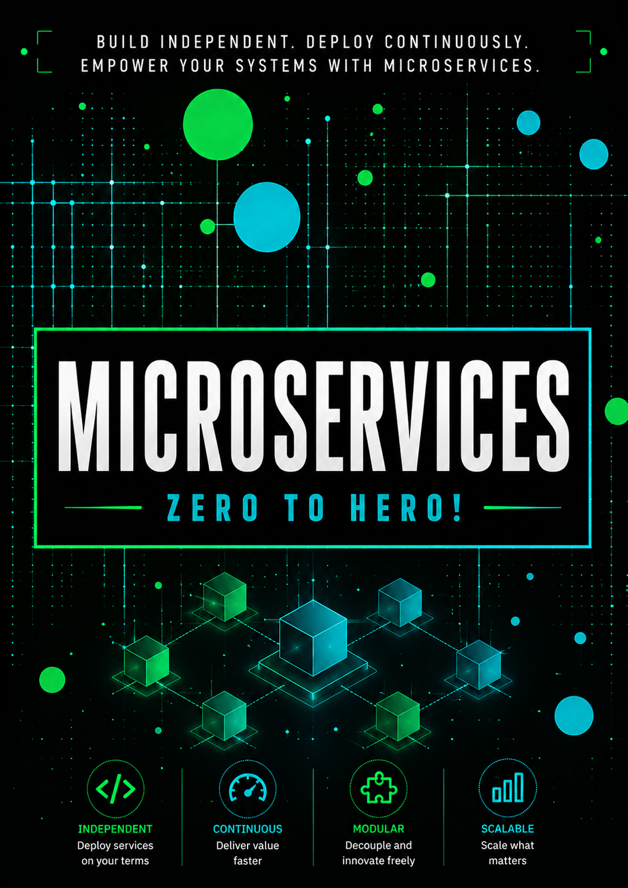
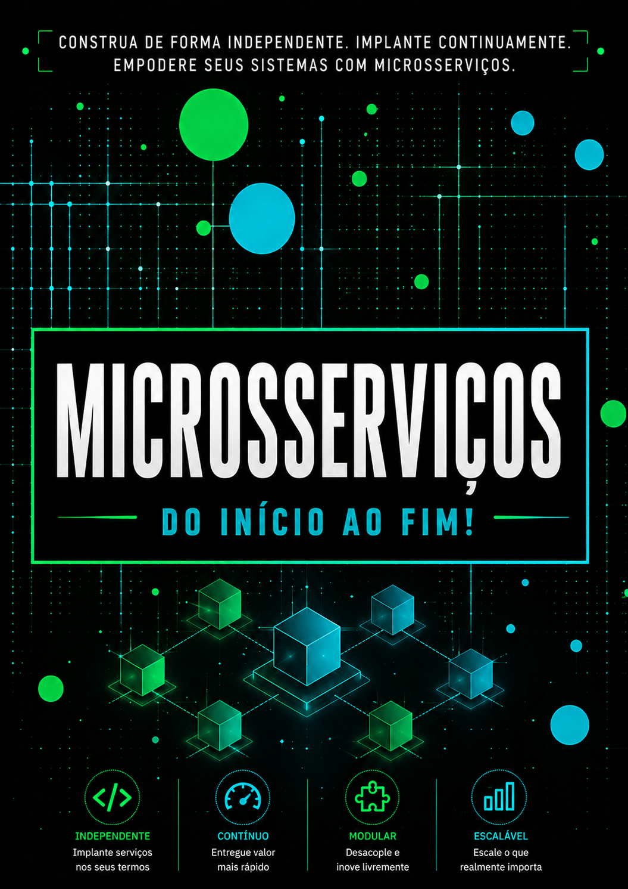

# Contact

### [Send your message](https://forms.gle/ZrWyKDZwXswsiyP7A)

# [Microservices](https://github.com/rafaelfgx/Microservices)

### Screaming Architecture, Clean Architecture, Event-Driven Architecture, Clean Code, DDD, SOLID, Test Pyramid, Patterns (Ambassador, Circuit Breaker, Mediator, Outbox, Result, Retry, Strategy), Java 25, Spring Boot 4, Kong, Keycloak, Kafka, MongoDB, Redis, Elastic, Testcontainers, Docker

# [Architecture](https://github.com/rafaelfgx/Architecture)

### .NET 11, Angular 22, Clean Architecture, Clean Code, SOLID, KISS, DRY, Mediator Pattern, Folder-by-Feature Structure

# [DotNetCore](https://github.com/rafaelfgx/DotNetCore)

### .NET 11 Nuget Packages | https://www.nuget.org/profiles/rafaelfgx

# [Node](https://github.com/rafaelfgx/Node)

### Node, Express, TypeScript, MongoDB, Vitest, Zod, Testcontainers, ESLint, Prettier, Folder-by-Feature Structure

# [AI](https://github.com/rafaelfgx/AI)

### Artificial Intelligence

# [Blockchain](https://github.com/rafaelfgx/Blockchain)

### Blockchain, Wallet, Smart Contracts, Token, NFT, SBT, DAO, Solidity

# [QuantumComputing](https://github.com/rafaelfgx/QuantumComputing)

### Core principles of Quantum Physics and Quantum Computing

# Ebooks

| MICROSERVICES | MICROSERVIÇOS |
| :-: | :-: |
|  |  |
| 
The content presents concepts and fundamentals of distributed systems and microservices, including a complete project available on GitHub! Perfect for those who wish to understand and apply this powerful architecture!
 | 
O conteúdo apresenta conceitos e fundamentos de sistemas distribuídos e microsserviços, incluindo um projeto completo disponível no GitHub! Perfeito para quem deseja compreender e aplicar essa poderosa arquitetura!
 |

| BLOCKCHAIN - CRYPTOCURRENCY | BLOCKCHAIN - CRIPTOMOEDAS |
| :-: | :-: |
|  |  |
| 
Dive into the universe of blockchain and cryptocurrencies that is revolutionizing the world! In this content, the disruptive power of this technology will be explored, ushering in a new era of decentralization, transparency, and security.
 
THIS CONTENT IS NOT ANY INVESTMENT RECOMMENDATION, IT IS FOR EDUCATIONAL PURPOSES ONLY!
 | 
Mergulhe no universo do blockchain e das criptomoedas que está revolucionando o mundo! Neste conteúdo, o poder disruptivo dessa tecnologia será explorado, inaugurando uma nova era de descentralização, transparência e segurança.
 
ESTE CONTEÚDO NÃO É NENHUMA RECOMENDAÇÃO DE INVESTIMENTO, É APENAS PARA FINS EDUCACIONAIS!
 |

# Contact

### [Send your message](https://forms.gle/ZrWyKDZwXswsiyP7A)
